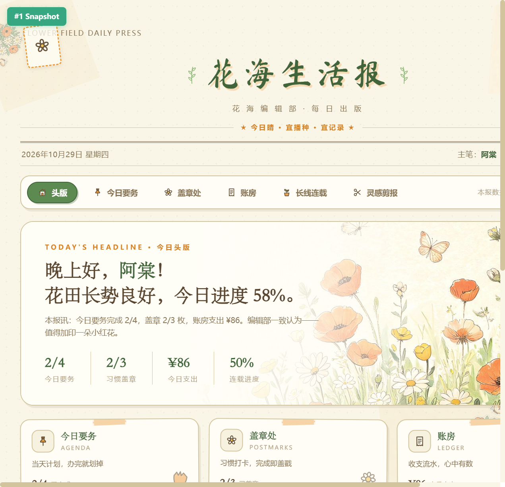
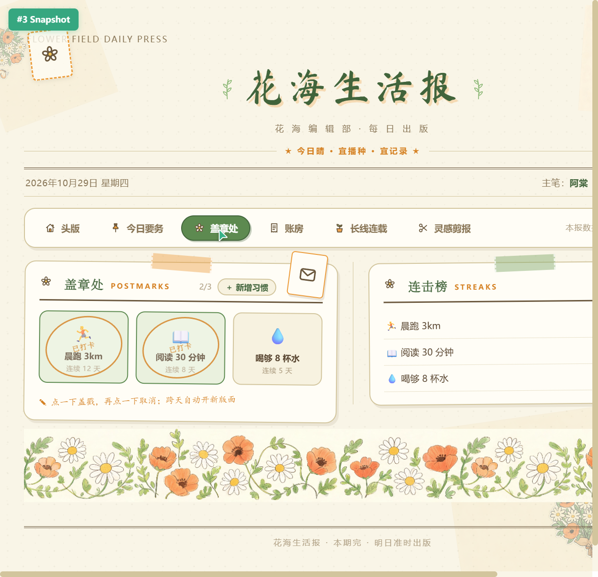

# 花海生活报 · Flower Field Daily Press

> 把日子过成连载，每天一小块版面 —— 一张手账风格的个人生活小报。

「花海生活报」是一个**纯本地存储**的单页应用：没有账号、没有服务器、没有构建步骤，打开就是一份每天"付印"的私人小报。适合想把日子过好的学生、上班族与自由职业者。

## ✨ 五个版面

| 版面 | 功能 |
| --- | --- |
| 📌 今日要务 AGENDA | 当天计划，点一下划掉，按优先级自动排序 |
| 🌸 盖章处 POSTMARKS | 习惯打卡，完成即盖戳，支持上传本地图片自选图章、连击统计 |
| 📖 账房 LEDGER | 收支流水、月度汇总、分类占比，全本地记账 |
| 🌱 长线连载 SERIALS | 长期目标养成：点「＋1」浇水，进度爬过 25% / 50% / 75% 里程碑开花，浇满收成 |
| ✂️ 灵感剪报 CLIPPINGS | 摘录、灵感与碎碎念，支持标签筛选、置顶、每日"旧稿重读" |

## 🚀 使用

无需安装依赖、无需构建，任选其一：

- **本地打开**：直接双击 `index.html`（桌面版）或 `mobile.html`（手机版）；
- **本地服务**：`python -m http.server 8000`，然后访问 `http://localhost:8000`；
- **托管部署**：任意静态托管（GitHub Pages、Qoder Site、Vercel 等），以仓库根目录为发布目录即可，构建命令留空。

所有数据保存在浏览器 `localStorage` 中，跨天自动重置打卡、保留连续记录。**清理浏览器数据会清空报纸存档，请留意。**

## 🧱 技术栈

- 原生 HTML / CSS / JavaScript + [Vue 3](https://vuejs.org/)（本地内置，无 CDN 依赖）
- 零构建、零后端，全站仅静态文件

## 📄 协议

本项目采用自定义 [LICENSE](LICENSE)：**仅供个人学习、研究使用**。

- ✅ 允许：克隆 / 拉取本仓库，本地运行、阅读、学习源码
- ❌ 禁止：任何商业用途；以任何形式再分发（含修改版）原版或修改后的代码与素材

任何超出上述范围的使用，请先通过 GitHub Issue 联系作者获得书面许可。
